# Awesome Open-Source Testing Ecosystem & SDKs 🧪⚡

  

  

**A curated, production-ready directory of top Open-Source Testing Frameworks, Automation SDKs, Load Testing Tools, and Enterprise SaaS Testing Clouds.**

*Accelerate QA pipelines, streamline E2E browser automation, run high-concurrency performance benchmarks, and orchestrate cross-browser real-device testing.*

[Explore SaaS Clouds](#-saas--hosted-platforms) • [Explore Open-Source Frameworks](#-open-source-software) • [Comparison Matrix](#-comparison-at-a-glance) • [Contributing](#-contributing) • [Support](#-support)

---

## 🧭 Overview & SEO Highlights 🔍

The modern software testing ecosystem spans multiple critical quality engineering layers:
- 🌐 **Web End-to-End (E2E) Automation:** Headless & headed browser orchestration across Chromium, Firefox, and WebKit (Playwright, Puppeteer, Cypress, Selenium).
- ⚡ **Unit, Component & Integration Test Runners:** Ultra-fast ESM runners with instant HMR and snapshot testing (Vitest, Jest).
- 📱 **Mobile Native & Hybrid Testing:** Cross-platform mobile automation for Android and iOS devices (Appium, WebdriverIO).
- 🚀 **Performance, Stress & Load Testing:** High-throughput protocol benchmarks and developer-friendly load scripting (k6, JMeter, Gatling).
- 🧪 **API Validation & Multi-Layer DSLs:** Unified schema assertions, mock servers, and contract testing (Karate, Robot Framework).
- ☁️ **Cloud Execution Infrastructure:** Scalable parallel execution grids and device clouds (BrowserStack, Sauce Labs, LambdaTest, Tricentis, Applitools).

---

## 📋 Table of Contents 📑

- [🧭 Overview & SEO Highlights](#-overview--seo-highlights-)
- [🟦 SaaS / Hosted Platforms](#-saas--hosted-platforms)
  - [📈 Sector Overview & Market Dynamics](#-sector-overview--market-dynamics)
  - [🏢 SaaS Platforms Matrix](#-saas-platforms-matrix)
- [🟩 Open-Source Software (Ranked by Stars ⭐)](#-open-source-software-ranked-by-stars-)
  - [1. Playwright (100k+ ⭐)](#1-playwright-100k-)
  - [2. Puppeteer (95k+ ⭐)](#2-puppeteer-95k-)
  - [3. Cypress (51k+ ⭐)](#3-cypress-51k-)
  - [4. Jest (45k+ ⭐)](#4-jest-45k-)
  - [5. Selenium (34k+ ⭐)](#5-selenium-34k-)
  - [6. k6 (32k+ ⭐)](#6-k6-32k-)
  - [7. Appium (22k+ ⭐)](#7-appium-22k-)
  - [8. Vitest (17k+ ⭐)](#8-vitest-17k-)
  - [9. Robot Framework (11k+ ⭐)](#9-robot-framework-11k-)
  - [10. TestCafe (9.8k+ ⭐)](#10-testcafe-98k-)
  - [11. WebdriverIO (9.8k+ ⭐)](#11-webdriverio-98k-)
  - [12. Karate (9.0k+ ⭐)](#12-karate-90k-)
  - [13. Apache JMeter (9.6k+ ⭐)](#13-apache-jmeter-96k-)
  - [14. Gatling (6.9k+ ⭐)](#14-gatling-69k-)
- [📊 Comparison Matrix at a Glance](#-comparison-matrix-at-a-glance)
- [📈 Star History](#-star-history)
- [💖 Support & Sponsorship](#-support--sponsorship)
- [🤝 Contributing](#-contributing)
- [📄 License](#-license)

---

## 🟦 SaaS / Hosted Platforms ☁️

Commercial, cloud-hosted testing platforms that support and contribute to the open-source ecosystem. These platforms provide managed execution grids, cross-browser/device infrastructure, and enterprise reporting to scale open-source testing suites without maintaining internal hardware labs.

### 📈 Sector Overview & Market Dynamics
The global software testing and cloud testing market is valued at approximately **$15B–$55B** (with cloud testing specifically scaling from ~$12B toward $45B+ at a ~13% CAGR), characterized by **moderate concentration at the top** (led by enterprise conglomerates and infrastructure giants) alongside **high fragmentation** driven by continuous waves of specialized point solutions, AI-native startups, and ubiquitous open-source frameworks.

### 🏢 SaaS Platforms Matrix

| Platform | Starting Price | Free Tier / Trial Limits | Company Size (Valuation / Revenue) | Primary Focus | Best For |
|---|---|---|---|---|---|
| **Tricentis** | $1,250/mo ($15,000/yr starting tier) | 14-day free trial upon request (No permanent free tier) | $4.5B valuation (~$500M ARR) | Enterprise continuous testing & test management | Large enterprise suites needing end-to-end multi-app automation |
| **BrowserStack** | $29/mo (Desktop Live, billed annually) | Free trial: 30 mins Live, 100 mins Automate; Free tier: Percy 5,000 screenshots/mo | $4.0B valuation (~$230M ARR) | Cross-browser & real device execution grid | Teams running Playwright/Cypress/Appium needing cloud scale & real devices |
| **Sauce Labs** | $39/mo (Live Testing, billed annually) | 28-day free trial: 60 testing minutes, 3 parallel VMs | $613M historical valuation (~$95M ARR) | Cross-browser, real device cloud & CI/CD error reporting | Enterprise CI/CD pipelines needing extensive historical analytics |
| **LambdaTest** | $15/mo (Virtual Live, billed annually) | Free Forever: 100 lifetime automation mins, 1 parallel session, 2,000 screenshots | $400M valuation (~$50M ARR) | High-speed cloud testing & AI test orchestration | Cost-conscious teams wanting fast parallel runs and AI test authoring |
| **Applitools** | $667/mo (Starter tier, billed annually) | 14-day free trial (No permanent free tier) | $250M acquisition valuation (~$30M ARR) | Automated visual regression & AI UI validation | Engineering teams needing automated visual pixel & DOM layout validation |

---

## 🟩 Open-Source Software (Ranked by Stars ⭐)

Self-hosted, community-driven testing frameworks, libraries, and SDKs. Ranked in descending order by GitHub stargazer count.

### 1. Playwright

- **Repository:** [microsoft/playwright](https://github.com/microsoft/playwright) 🔗
- **Stack:** TypeScript / Node.js (core), with Python, Java, .NET bindings 💻 | **License:** Apache-2.0 📜
- **Overview:** Playwright (Microsoft) is the modern web automation framework of choice, running tests against **Chromium, Firefox, and WebKit from a single unified API** with auto-waiting that eliminates flaky manual sleep calls. It parallelizes test runs out of the box, provides browser context isolation for blazing-fast parallel execution, and includes an interactive trace viewer, codegen tool, and native MCP server support.
- **Trade-off:** Uses Playwright's patched WebKit build rather than real macOS Safari, and does not test native mobile apps directly.
- **Best For:** Modern E2E web testing suites needing high speed, zero-flakiness auto-waiting, and cross-browser reliability.

---

### 2. Puppeteer

- **Repository:** [puppeteer/puppeteer](https://github.com/puppeteer/puppeteer) 🔗
- **Stack:** JavaScript / Node.js 💻 | **License:** Apache-2.0 📜
- **Overview:** Puppeteer (Google Chrome team) provides a high-level Node.js API to control Chrome, Chromium, and Firefox over the Chrome DevTools Protocol (CDP) and WebDriver BiDi. It is widely utilized for automated UI verification, crawler automation, PDF generation, performance telemetry, and headless browser workflows.
- **Trade-off:** Primarily centered on Chromium/Chrome ecosystems; lacking out-of-the-box cross-language bindings compared to Playwright or Selenium.
- **Best For:** Node.js developers needing lightweight, low-level browser automation, automated scraping, PDF/screenshot generation, and CDP profiling.

---

### 3. Cypress

- **Repository:** [cypress-io/cypress](https://github.com/cypress-io/cypress) 🔗
- **Stack:** JavaScript / TypeScript 💻 | **License:** MIT 📜
- **Overview:** Cypress pioneered the developer-experience-first paradigm for frontend E2E and component testing, executing test code **directly inside the browser run-loop**. It provides time-travel debugging with interactive DOM snapshots at every execution step, automatic video/screenshot capture on failure, and an intuitive visual test runner.
- **Trade-off:** JS/TS only; in-browser execution architecture introduces strict constraints around multi-tab and cross-domain test workflows; mobile native apps are not supported.
- **Best For:** Frontend engineering teams prioritizing developer experience, fast feedback loops, and component testing within JavaScript/TypeScript apps.

---

### 4. Jest

- **Repository:** [jestjs/jest](https://github.com/jestjs/jest) 🔗
- **Stack:** JavaScript / TypeScript 💻 | **License:** MIT 📜
- **Overview:** Jest (Meta / OpenJS Foundation) is the ubiquitous JavaScript testing framework with a focus on simplicity. It provides zero-configuration setups for Babel/Webpack/React projects, built-in mocking utilities, snapshot testing, and isolated parallel runner processes for unit and integration testing.
- **Trade-off:** Slower execution performance and heavier resource footprint on large modern ESM codebases compared to next-generation Vite-native runners like Vitest.
- **Best For:** Large-scale JavaScript/Node/React unit and integration test suites requiring comprehensive out-of-the-box mocking and snapshot testing.

---

### 5. Selenium

- **Repository:** [SeleniumHQ/selenium](https://github.com/SeleniumHQ/selenium) 🔗
- **Stack:** Java (core), with Python, C#, Ruby, JavaScript bindings 💻 | **License:** Apache-2.0 📜
- **Overview:** Selenium is the battle-tested, language-agnostic foundation of browser automation, standardized via W3C WebDriver. It supports all commercial browsers, legacy browser engines, real Safari via `safaridriver`, and scales globally via distributed Selenium Grid configurations.
- **Trade-off:** Requires explicit wait management and boilerplate harness code; slower execution speeds than Playwright.
- **Best For:** Enterprise test suites requiring extensive multi-language support (Java/C#/Python), real Safari validation, or backwards compatibility across legacy infrastructure.

---

### 6. k6

- **Repository:** [grafana/k6](https://github.com/grafana/k6) 🔗
- **Stack:** Go (engine) / JavaScript (scripting API) 💻 | **License:** AGPL-3.0 📜
- **Overview:** k6 (Grafana Labs) is a modern developer-centric load and performance testing tool. Written in Go for ultra-low memory overhead, it allows engineers to write test scenarios in familiar JavaScript/ES6 syntax with built-in threshold validation, CI/CD integrations, and native Prometheus/Grafana observability.
- **Trade-off:** Node.js native packages cannot be executed directly (it runs a bundled JS VM in Go); AGPL-3.0 license.
- **Best For:** Engineering teams demanding developer-friendly, scriptable load tests, write-intensive API benchmarking, and automated CI/CD performance regression gates.

---

### 7. Appium

- **Repository:** [appium/appium](https://github.com/appium/appium) 🔗
- **Stack:** Node.js (core), with Java, Python, Ruby, C#, JS clients 💻 | **License:** Apache-2.0 📜
- **Overview:** Appium is the industry-standard open-source ecosystem for automating **native, hybrid, and mobile web applications across Android and iOS**. Driven by the W3C WebDriver specification, it interfaces with UiAutomator2, Espresso, and XCUITest drivers, executing seamlessly across local emulators and remote device clouds.
- **Trade-off:** Significant initial setup dependencies (Android SDK, Xcode CLI); selector volatility requires ongoing maintenance.
- **Best For:** Mobile QA engineers needing full native code-level control over Android and iOS UI automation without embedding proprietary SDKs into the app binary.

---

### 8. Vitest

- **Repository:** [vitest-dev/vitest](https://github.com/vitest-dev/vitest) 🔗
- **Stack:** TypeScript / Vite 💻 | **License:** MIT 📜
- **Overview:** Vitest is a blazing-fast, Vite-native unit and component test framework. It shares Vite's configuration, transform pipeline, and HMR engine, providing instant re-runs on file changes, Jest-compatible APIs, native ESM/TypeScript execution, multi-threading worker pools, and browser-mode testing.
- **Trade-off:** Highly optimized for modern Vite ecosystems; older Webpack setups require additional configuration layers.
- **Best For:** Modern web applications, Vue/React/Svelte libraries, and TypeScript codebases built on Vite looking for instantaneous unit/component test execution.

---

### 9. Robot Framework

- **Repository:** [robotframework/robotframework](https://github.com/robotframework/robotframework) 🔗
- **Stack:** Python 💻 | **License:** Apache-2.0 📜
- **Overview:** Robot Framework is a generic, keyword-driven automation engine for acceptance testing, acceptance test-driven development (ATDD), and robotic process automation (RPA). It features human-readable tabular syntax, rich extensible Python libraries, data-driven test generation, and clear execution reporting.
- **Trade-off:** Keyword abstraction adds architectural indirection; complex custom logic requires custom Python keyword implementation.
- **Best For:** Cross-functional teams involving QA analysts, product owners, and non-programmers requiring readable keyword-driven acceptance tests.

---

### 10. TestCafe

- **Repository:** [DevExpress/testcafe](https://github.com/DevExpress/testcafe) 🔗
- **Stack:** JavaScript / TypeScript 💻 | **License:** MIT 📜
- **Overview:** TestCafe (DevExpress) executes automated end-to-end web tests **without requiring WebDriver or native browser plugins**. By serving as a reverse proxy that injects driver scripts directly into the DOM, it eliminates driver compatibility mismatches and supports testing across remote devices simply by visiting a generated URL.
- **Trade-off:** Smaller community footprint compared to Playwright and Cypress; lacks native mobile app testing.
- **Best For:** Small QA teams looking for zero-configuration, plug-and-play web automation without browser binary management.

---

### 11. WebdriverIO

- **Repository:** [webdriverio/webdriverio](https://github.com/webdriverio/webdriverio) 🔗
- **Stack:** JavaScript / TypeScript 💻 | **License:** MIT 📜
- **Overview:** WebdriverIO (OpenJS Foundation) is an extensible progressive automation framework that unifies desktop browser testing (via WebDriver and WebDriver BiDi) and native mobile testing (via Appium) under a single modern JavaScript/TypeScript API with an expansive plugin ecosystem.
- **Trade-off:** Mobile tests still inherit underlying Appium configuration overhead; configuration options can be verbose for custom setups.
- **Best For:** Full-stack JavaScript and TypeScript teams looking for one unified framework covering both cross-browser web and native mobile test suites.

---

### 12. Karate

- **Repository:** [karatelabs/karate](https://github.com/karatelabs/karate) 🔗
- **Stack:** Java 💻 | **License:** MIT 📜
- **Overview:** Karate is an open-source test-automation platform that combines **API testing, API mocks, performance testing, and UI automation** into a unified, readable domain-specific language (DSL). It supports native parallel multi-threaded test execution out of the box without requiring Java coding.
- **Trade-off:** Custom DSL syntax can become constrained for intricate edge-case logic; Java runtime requirement.
- **Best For:** Backend API test automation, microservice integration testing, and unified API+UI workflows in enterprise Java environments.

---

### 13. Apache JMeter

- **Repository:** [apache/jmeter](https://github.com/apache/jmeter) 🔗
- **Stack:** Java 💻 | **License:** Apache-2.0 📜
- **Overview:** Apache JMeter is the industry's longest-standing open-source load and performance testing tool. It provides a visual GUI workbench for building multi-step test plans, supports a broad protocol spectrum (HTTP, HTTPS, SOAP, REST, JDBC, LDAP, JMS, TCP), and distributes massive load via remote master-slave worker nodes.
- **Trade-off:** Higher memory overhead per virtual user thread than modern asynchronous engines (like k6 or Gatling); XML-based `.jmx` test files are difficult to version-control in Git.
- **Best For:** Teams requiring a protocol-rich performance testing tool with a visual test plan designer and mature distributed testing capabilities.

---

### 14. Gatling

- **Repository:** [gatling/gatling](https://github.com/gatling/gatling) 🔗
- **Stack:** Scala / Java / Kotlin 💻 | **License:** Apache-2.0 📜
- **Overview:** Gatling is a high-performance load testing engine built on the Akka actor model and Netty async I/O. It treats test scenarios as version-controlled code via expressive Scala, Java, or Kotlin DSLs, achieving remarkable resource efficiency and rendering interactive HTML performance dashboards.
- **Trade-off:** Scala/JVM learning curve for non-JVM teams; test durations can be longer than raw C/Go engines on mixed workloads.
- **Best For:** JVM-centric engineering teams demanding code-as-configuration load tests with exceptional concurrency handling and memory efficiency.

---

## 📊 Comparison Matrix at a Glance 🔍

| Framework / Tool | GitHub Stars ⭐ | Primary Testing Focus | Execution Model | Native Mobile | Best For |
|---|---|---|---|---|---|
| **Playwright** | 100k+ | Web E2E & Component | CDP / BiDi Out-of-Process | ❌ | Modern, fast cross-browser E2E |
| **Puppeteer** | 95k+ | Browser Automation & Scraping | Chrome DevTools Protocol | ❌ | Headless Node.js CDP automation |
| **Cypress** | 51k+ | Web E2E & Component | In-Browser Execution Loop | ❌ | Developer experience & component testing |
| **Jest** | 45k+ | Unit & Integration Testing | Node.js Process Isolation | ❌ | Universal JS/React unit testing |
| **Selenium** | 34k+ | Web Automation | W3C WebDriver Protocol | (Via Appium) | Enterprise multi-language & real Safari |
| **k6** | 32k+ | Load & Performance Testing | Go Engine + JS VM | ❌ | Developer-friendly API load testing & CI gates |
| **Appium** | 22k+ | Native & Hybrid Mobile | WebDriver (XCUITest / UiAutomator2) | ✅ iOS & Android | Native iOS & Android automated testing |
| **Vitest** | 17k+ | Unit & Component Testing | Vite Engine + Worker Threads | ❌ | Blazing-fast Vite-native ESM testing |
| **Robot Framework** | 11k+ | Keyword-Driven Acceptance & RPA | Python Keyword Runner | (Via Appium) | Human-readable acceptance testing |
| **TestCafe** | 9.8k+ | Web E2E Automation | Reverse Proxy DOM Injection | ❌ | Driverless zero-config web testing |
| **WebdriverIO** | 9.8k+ | Web & Mobile E2E | WebDriver & BiDi + Appium | ✅ (Via Appium) | Unified JS framework for web & mobile |
| **Karate** | 9.0k+ | API, Mocking & UI DSL | Java DSL Runner | ❌ | Unified API testing & parallel execution |
| **Apache JMeter** | 9.6k+ | Protocol Load & Stress | Multi-Threaded Java Engine | ❌ | Protocol-rich GUI-based load testing |
| **Gatling** | 6.9k+ | High-Throughput Load Testing | Netty Async / Akka Actors | ❌ | JVM code-first load testing & dashboards |

---

## 📈 Star History

---

## 💖 Support & Sponsorship ☕

Thank you for visiting and supporting the **Awesome Open-Source Testing Ecosystem & SDKs** project! 🙏

If this curated repository saved you time, helped you evaluate test automation architectures, or streamlined your QA engineering stack, please consider supporting the project:

- ⭐ **Star this repository** on GitHub to help more developers discover it.
- 🍴 **Fork and share** with your teammates, QA engineering circles, and DevOps communities.
- 📢 **Spread the word** on LinkedIn, X/Twitter, Discord, and Reddit.
- ☕ **Sponsor / Buy a Coffee:** You can sponsor this project and support continuous open-source curation on GitHub Sponsors:

👉 **[Visit the Sponsor Dashboard (github.com/sponsors/ishandutta2007)](https://github.com/sponsors/ishandutta2007)**

---

## 🤝 Contributing 🚀

Contributions are warmly welcome! If you know of an open-source testing framework, load test engine, or test assertion library that should be featured:

1. Check that the repository has active maintenance (releases or commits within the past 12 months).
2. Ensure it is genuinely open-source with an OSI-approved license.
3. Open a Pull Request with project details, GitHub URL, license, and architectural standout features.

---

## 📄 License ⚖️

This list is released under [CC0 1.0 Universal (Public Domain)](https://creativecommons.org/publicdomain/zero/1.0/). The software frameworks and tools listed retain their respective open-source licenses.

---

⭐ **If this list helped you discover a useful tool, please star the repo!** ⭐

